# Архітектура шарів сторінок і даних

Схема потрібна аналітику, щоб бачити шлях даних від сторінки до MongoDB перед уточненням вимог: які екрани ходять через `app/api/`, які викликають сервіси напряму через `app/di/`, і від яких репозиторіїв і моделей залежить кожен сервіс.

Діаграма нижче показує основні маршрути `app/[lang]/`, пов’язані API-ендпоінти, сервіси з `app/services/` та інфраструктуру в `app/infrastructure/` (репозиторії й моделі). Частина сторінок отримує дані через DI-контейнер (`app/di/container.ts`) без HTTP; форми й службові маршрути без сервісного шару також позначені.

```mermaid
flowchart TD
  subgraph pages["app/[lang]"]
    home["page.tsx"]
    about["about-us/page.tsx"]
    biography["biography/page.tsx"]
    artistry["artistry/page.tsx"]
    research["research/page.tsx"]
    archive["archive/page.tsx"]
    archiveCase["archive/[fund]/[case]/page.tsx"]
    news["news/page.tsx"]
    cooperation["cooperation/page.tsx"]
    support["support-us/page.tsx"]
    contacts["contacts/page.tsx"]
    privacy["privacy-policy/page.tsx"]
  end

  subgraph api["app/api"]
    apiPage["page/route.ts"]
    apiHeader["header/route.ts"]
    apiFunds["funds/route.ts"]
    apiCompData["compositions/data/route.ts"]
    apiCompFilters["compositions/filters/route.ts"]
    apiCompTitles["compositions/titles/route.ts"]
    apiSciData["scientific-works/data/route.ts"]
    apiSciFilters["scientific-works/filters/route.ts"]
    apiSciTitles["scientific-works/titles/route.ts"]
    apiCollab["collaboration/route.ts"]
    apiBlob["blob-url/route.ts"]
  end

  subgraph services["app/services"]
    resolvePage["pages-data/resolvePageData.ts"]
    pagesDataSvc["pages-data/pagesDataService.ts"]
    artistrySvc["artistry/artistryService.ts"]
    scientificSvc["scientific-works/scientificWorks.ts"]
    fundsSvc["funds/fundsService.ts"]
    newsSvc["news/newsService.ts"]
    mediaSvc["media-mentions/mediaMentionService.ts"]
    headerSvc["header/headerService.ts"]
    footerSvc["footer/footerService.ts"]
  end

  subgraph infra["app/infrastructure"]
    subgraph repos["repositories"]
      pagesRepo["pages-data/pagesData.repository.ts"]
      compositionsRepo["artistry/compositions.repository.ts"]
      scientificRepo["scientific-works/scientificWorks.repository.ts"]
      fundsRepo["funds/funds.repository.ts"]
      newsRepo["news/news.repository.ts"]
      mediaRepo["media-mentions/mediaMention.repository.ts"]
      foundationRepo["foundation-info/foundationInfo.repository.ts"]
      navigationRepo["navigation/navigation.repository.ts"]
    end

    subgraph models["models"]
      pagesModel["pages/pages.ts"]
      draftPagesModel["pages/draftPages.model.ts"]
      compositionsModel["artistry/artistryTableData.ts"]
      scientificModel["scientific-works/scientificWorksTableData.ts"]
      fundModel["archive/Fund.ts"]
      caseModel["archive/Case.ts"]
      newsModel["news/news.model.ts"]
      mediaModel["media-mentions/mediaMention.model.ts"]
      foundationModels["foundation-info/*"]
      navigationModel["navigation/navigation.ts"]
    end
  end

  di["app/di/container.ts"] -.-> pagesDataSvc
  di -.-> artistrySvc
  di -.-> scientificSvc
  di -.-> fundsSvc
  di -.-> newsSvc
  di -.-> mediaSvc
  di -.-> headerSvc
  di -.-> footerSvc

  home --> resolvePage
  about --> resolvePage
  biography --> resolvePage
  privacy --> resolvePage
  research --> resolvePage
  cooperation --> pagesDataSvc
  resolvePage --> pagesDataSvc

  research --> apiSciData
  research --> apiSciFilters
  research --> apiSciTitles
  artistry --> apiCompData
  artistry --> apiCompFilters
  artistry --> apiCompTitles
  artistry --> apiBlob
  archive --> apiFunds
  archiveCase --> fundsSvc
  news --> newsSvc
  news --> mediaSvc
  contacts --> footerSvc
  support --> footerSvc
  cooperation --> apiCollab

  apiPage --> pagesDataSvc
  apiHeader --> headerSvc
  apiFunds --> fundsSvc
  apiCompData --> artistrySvc
  apiCompFilters --> artistrySvc
  apiCompTitles --> artistrySvc
  apiSciData --> scientificSvc
  apiSciFilters --> scientificSvc
  apiSciTitles --> scientificSvc

  pagesDataSvc --> pagesRepo
  artistrySvc --> compositionsRepo
  scientificSvc --> scientificRepo
  fundsSvc --> fundsRepo
  newsSvc --> newsRepo
  mediaSvc --> mediaRepo
  headerSvc --> foundationRepo
  headerSvc --> navigationRepo
  footerSvc --> foundationRepo
  footerSvc --> navigationRepo

  pagesRepo --> pagesModel
  pagesRepo --> draftPagesModel
  compositionsRepo --> compositionsModel
  scientificRepo --> scientificModel
  fundsRepo --> fundModel
  fundsRepo --> caseModel
  newsRepo --> newsModel
  mediaRepo --> mediaModel
  foundationRepo --> foundationModels
  navigationRepo --> navigationModel
```

